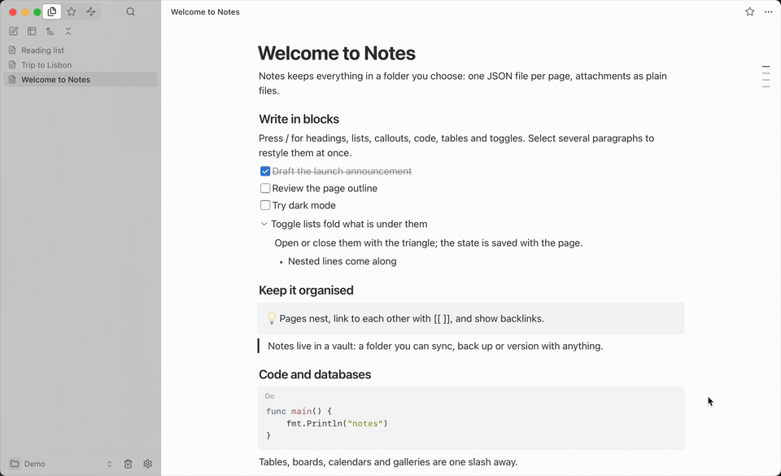
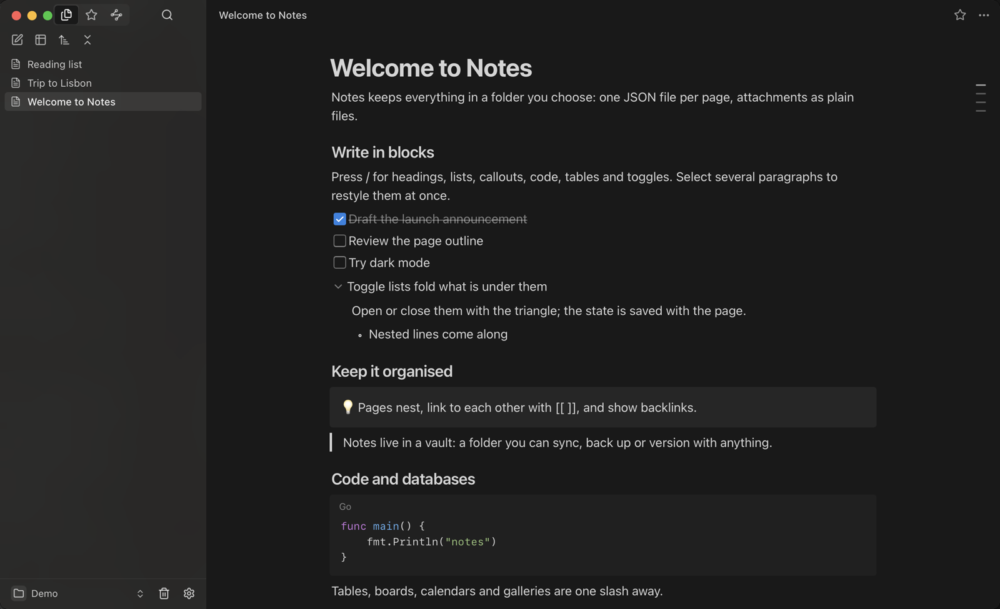
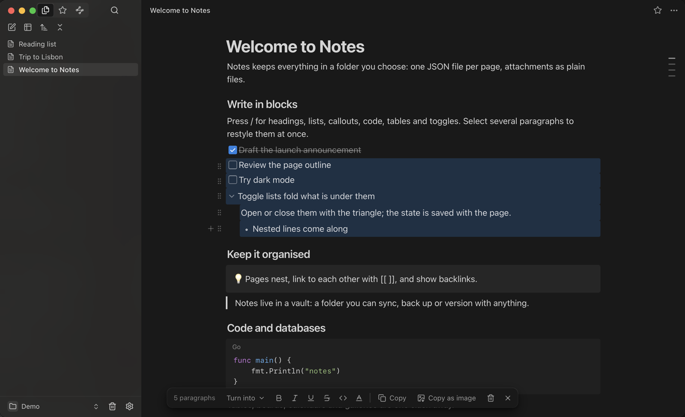
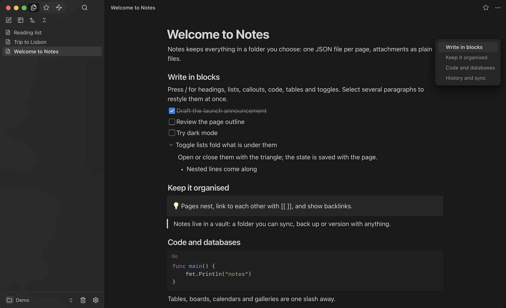

<p align="center">
  
</p>

<h1 align="center">Notes</h1>

<p align="center">
  A personal notes app for the desktop: blocks, nested pages, databases, backlinks, history,
  light and dark, in English and 简体中文. Your notes are plain files in a folder you choose.
</p>

<p align="center">
  
</p>

The interface is a web page in the system's own webview (WKWebView on macOS,
WebKitGTK on Linux, WebView2 on Windows); the app is written with
[MyGo](https://github.com/egoist/mygo), in Go, so it is one small binary.

Notes live in a **vault**: a folder you choose. Each page is one JSON file,
attachments are plain files, and nothing else is needed. A vault can also be
kept in a WebDAV or SMB folder, which then syncs with the copy on this
computer.

## What it does

- **A block editor.** Type `/` for headings, to-dos, lists, quotes, callouts, code,
  tables, toggle lists and databases. Markdown shortcuts work as you type.
- **Style many paragraphs at once.** Select several, and the bar at the foot of the
  page turns them into another kind, makes them bold, italic, underlined,
  struck through or code, and colours them.
- **Toggle lists** that fold what is under them, kept with the page.
- **A page outline.** Short lines at the page's right edge, one for each heading:
  point at them to read the headings, press one to go there.
- **Pages inside pages**, links with `[[ ]]`, backlinks and a graph.
- **Databases** as table, board, list, gallery and calendar views.
- **History.** Every page keeps its recent versions; restore any of them.
- **Copy as image**, with the pictures among the words.
- **Light, dark or the system's**, and a translucent sidebar on macOS.
- **Sync** with a WebDAV or SMB folder, merging pages paragraph by paragraph.
- **Updates** from this repository's releases, signed.

<p align="center">
  
</p>

<p align="center">
  
</p>

<p align="center">
  
</p>

## Layout

```
main.go              starts the app (frontend.Run)
mygo.json            name, identifier, version, and the frontend's build commands
frontend/            the windows, menus, the services the page calls, the vault:// scheme
internal/vault/      records in memory, JSON files on disk, external changes, backup import
internal/sync/       manifest, sync rounds, three-way merge of pages
internal/storage/    remote folders: WebDAV, SMB, and a local folder (for tests)
internal/settings/   recent vaults and remote folders, in settings.json
web/                 the React interface (src/), and its tests and build
```

The web app keeps the same record model as before. In the desktop app, its
records are saved to the vault by the Go service; in a plain browser (`npm run
dev` in `web/`) they stay in IndexedDB, which is useful for working on the
interface alone.

## Download

Installers for macOS, Windows and Linux are on the
[releases page](https://github.com/mcxen/notes/releases). The macOS app is
signed ad hoc and not notarized: open it with right-click › Open the first
time. The Windows installer is not code-signed.

## Run it

Requires Go 1.27.3 or newer and Node.js 24 or newer.

```sh
go tool mygo dev         # the app, with the web app's dev server
go tool mygo build       # a packaged app in build/
```

Browser-only development:

```sh
cd web
npm ci
npm run dev              # http://127.0.0.1:8870, notes kept in the browser
```

## Vault format

```
MyVault/
├── pages/<page id>.json        the page and all of its paragraphs
├── attachments/...             files, as they were uploaded
└── .notes/
    ├── vault.json              format version and vault id
    ├── workspace.json          preferences and the list of roots
    ├── history/<page>/<id>.json  checkpoints of a page
    └── conflicts/              the other version of a page after a sync conflict
```

Files are written with the same bytes every time for the same content, and a
save replaces the file in one step. Changes made to the folder by other
programs (or by a sync tool) are merged in record by record; a paragraph or
field with changes not yet saved keeps this window's value.

## Sync

**File › Connect to a Remote Folder…** keeps a vault in a WebDAV folder (for
example Nextcloud, Synology or Jianguoyun) or an SMB share. The folder is
copied into a working copy on this computer, which is what the window edits,
and the two are synced:

- a few seconds after an edit, every five minutes, when the window gains focus,
  and on **File › Sync Now** (⇧⌘S / Ctrl+Shift+S);
- a page both sides changed is merged paragraph by paragraph and field by
  field; where the same field changed on both sides, this computer's value
  is kept and the other version is saved under `.notes/conflicts/`;
- any other file changed on both sides is kept twice, the second copy named
  `name (冲突 device date).ext`;
- a deletion moves the file to a `.trash/<date>/` folder on the side that
  does not have it, rather than removing it.

Passwords go to the system's credential store (Keychain, Credential Manager,
Secret Service), never to the settings file. The settings window (⌘,) shows
each remote vault's last sync, its recent syncs, the files sync moved out of
the way (with Restore), and the conflicts it kept.

## Tests

`go build -tags e2e` adds MyGo's automation plugin, so a running app can be
driven and captured with `mygo-automation` (`MYGO_AUTOMATION=<socket>`).

```sh
go vet ./...
CGO_ENABLED=0 go test ./...
cd web && npm test && npm run build
```

The Go tests use temporary folders, and a WebDAV server running in-process.
The SMB adapter is not yet tested against a live server.

## Not in this version

- The macOS app is not notarized and the Windows installer is not code-signed;
  updates are checked against a signing key instead (see Download).
- The sync interval is fixed at five minutes.
- A browser backup can be imported into a vault from the sidebar menu (Import
  browser backup…). The desktop app does not export backups yet.
- The macOS windows were checked on a running app. Windows and Linux windows,
  and real WebDAV services other than the in-process test server, have not
  been checked on those systems. The SMB adapter has no live test yet.

## Provenance and license status

Adapted from Terminus Notes, published by Terminus as `@terminus/notes`, version 0.0.1, retrieved through an existing fork. The original editor and UI code are retained with a new local persistence layer, local file storage, backup and restore, and standalone build scripts. This project is an independent adaptation and is not presented as the original author's work or an official release.

No license was included with the original source, and none has been added here. See `NOTICE` for attribution; third-party dependencies retain their own licenses.
