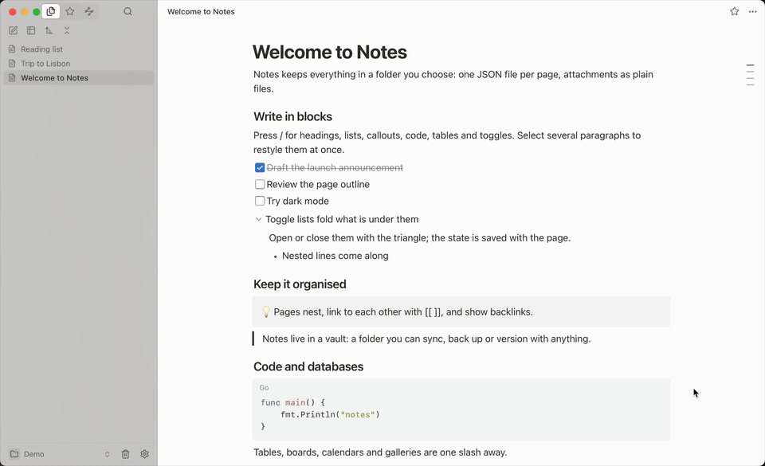
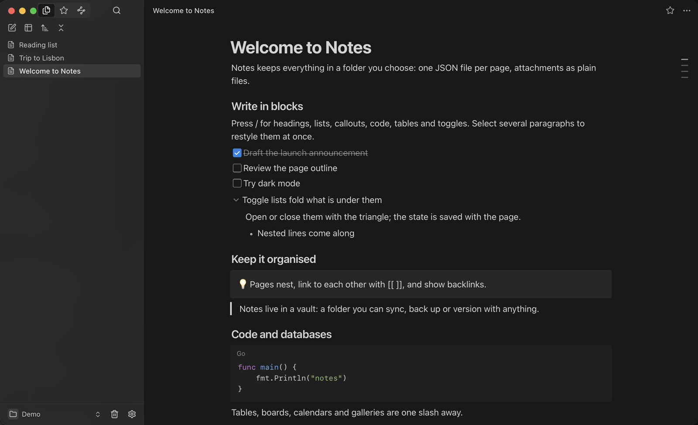

<p align="center">
  
</p>

<h1 align="center">Notes</h1>

<p align="center">
  A desktop notes app: blocks, nested pages, databases, backlinks, history, light and dark,
  in English and 简体中文. Your notes are plain files in a folder you choose.
</p>

<p align="center">
  <a href="https://notes.xpai.uk">notes.xpai.uk</a>
</p>

<p align="center">
  
</p>

Built with [MyGo](https://github.com/egoist/mygo) in Go: a single small binary that shows a web UI
in the system webview (WKWebView, WebKitGTK, WebView2).

## Features

- **Block editor**: `/` menu for headings, to-dos, lists, quotes, callouts, code, tables, toggles and databases; Markdown shortcuts.
- **Bulk styling**: select several paragraphs to convert, format or colour them at once.
- **Page outline**, pages inside pages, `[[links]]`, backlinks and a graph.
- **Databases**: table, board, list, gallery and calendar views.
- **History** with restore, **find and replace** (⌘F), **copy as image**.
- **Themes**: light, dark or system.
- **Sync** with WebDAV or SMB, merging pages paragraph by paragraph.
- **Signed updates** from this repository's releases.

<p align="center">
  
</p>

## Download

Installers for macOS, Windows and Linux are on the [releases page](https://github.com/mcxen/notes/releases).
The macOS app is ad-hoc signed and not notarized: right-click › Open the first time.
The Windows installer is not code-signed.

## Development

Requires Go 1.27.3+ and Node.js 24+.

```sh
go tool mygo dev         # app with the web dev server
go tool mygo build       # packaged app in build/
```

Browser only (notes kept in IndexedDB):

```sh
cd web && npm ci && npm run dev    # http://127.0.0.1:8870
```

Tests:

```sh
go vet ./...
CGO_ENABLED=0 go test ./...
cd web && npm test && npm run build
```

## Layout

```
main.go              starts the app
mygo.json            app name, identifier, version, build commands
frontend/            windows, menus, services, vault:// scheme
internal/vault/      records, JSON files on disk, external changes, backup import
internal/sync/       manifest, sync rounds, three-way page merge
internal/storage/    WebDAV, SMB, local folder (tests)
internal/settings/   recent vaults and remote folders
web/                 React interface, tests, build
```

## Vault format

```
MyVault/
├── pages/<page id>.json        a page and its paragraphs
├── attachments/...             uploaded files
└── .notes/
    ├── vault.json              format version, vault id
    ├── workspace.json          preferences, roots
    ├── history/<page>/<id>.json
    └── conflicts/              losing version after a sync conflict
```

Writes are deterministic and atomic. External changes are merged record by record.

## Sync

**File › Connect to a Remote Folder…** links a vault to WebDAV (Nextcloud, Synology, Jianguoyun…) or SMB.
It syncs shortly after edits, every five minutes, on window focus, and via **Sync Now** (⇧⌘S / Ctrl+Shift+S).

- Pages changed on both sides are merged per paragraph and field; on a field conflict this computer wins and the other version goes to `.notes/conflicts/`.
- Other files changed on both sides are kept twice (`name (冲突 device date).ext`).
- Deletions move the file to `.trash/<date>/` on the other side.

Passwords are stored in the system credential store, never in settings.

## Limitations

- Not notarized (macOS) or code-signed (Windows); updates are verified by signing key.
- Sync interval is fixed at five minutes.
- Browser backups can be imported (sidebar menu), but the desktop app cannot export yet.
- Only macOS has been verified on a running app; Windows, Linux, real WebDAV services and SMB are untested.

## License

[AGPL-3.0](LICENSE). Adapted from Terminus Notes (`@terminus/notes` 0.0.1, via an existing fork); the original had no license.
This is an independent adaptation, not an official release. See `NOTICE` for attribution; dependencies keep their own licenses.

Thanks to [LinuxDo](https://linux.do/)
